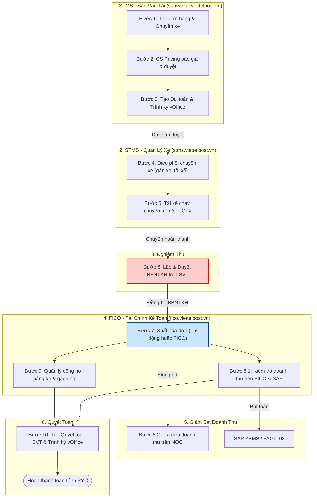

# TỔNG QUAN CHU TRÌNH 10 BƯỚC VẬN HÀNH & GHI NHẬN DOANH THU
## HỆ THỐNG SÀN VẬN TẢI (SMART TMS) - VIETTEL POST

> **Tài liệu nguồn:** Slide Đào tạo đơn vị ghi nhận doanh thu SVT (10/2026) & HDSD Hệ thống Sàn Vận Tải  
> **Áp dụng:** Toàn bộ đơn vận chuyển nguyên chuyến thực hiện qua Sàn Vận Tải (thay thế hoàn toàn luồng cũ E2 -> HR -> NOC).

---

## 1. SƠ ĐỒ LUỒNG TOÀN TRÌNH 10 BƯỚC (END-TO-END WORKFLOW)

---

## 2. MA TRẬN PHÂN CÔNG & HỆ THỐNG THAO TÁC (10 BƯỚC CHI TIẾT)

| Bước | Tên bước | Hệ thống thực hiện | Đường dẫn | Đối tượng thực hiện | Thao tác cốt lõi |
|:---:|---|---|---|---|---|
| **1** | **Tạo đơn hàng** | STMS - Sàn Vận Tải | `sanvantai.viettelpost.vn` | Sales / Kinh doanh | Tạo đơn lẻ hoặc Import Excel; nhập chi phí dự kiến & báo giá. Tạo chuyến xe. |
| **2** | **CS Pricing báo giá** | STMS - Sàn Vận Tải | `sanvantai.viettelpost.vn` | CS Pricing | Báo giá khách hàng, phê duyệt giá. Đơn chuyển trạng thái "Đã duyệt giá". |
| **3** | **Tạo dự toán** | STMS - Sàn Vận Tải | `sanvantai.viettelpost.vn` | Sales / Lãnh đạo | Gom đơn, chọn biểu mẫu tỷ lệ Doanh thu - Chi phí - Lợi nhuận tạm tính. Lưu & Trình ký vOffice. |
| **4** | **Điều phối chuyến xe** | STMS - Quản Lý Xe | `stms.viettelpost.vn` | BPVH / Điều vận | Nhận thông tin chuyến xe từ SVT, gán xe và tài xế (Web QLX). |
| **5** | **Tài xế thực hiện** | STMS QLX Mobile | App tài xế | Tài xế | Nhận chuyến, cập nhật lộ trình thực tế, xác nhận hoàn thành chuyến xe. |
| **6** | **Tạo BBNTKH** | STMS - Sàn Vận Tải | `sanvantai.viettelpost.vn` | Kinh doanh / BPVH | Lập Biên bản nghiệm thu khách hàng, trình duyệt. Khi duyệt xong $\rightarrow$ Tự động đồng bộ FICO. |
| **7** | **Xuất hóa đơn** | FICO | `fico.viettelpost.vn` | Kế toán / Tự động | Xuất tự động từ SVT hoặc kế toán xuất trên FICO (Kèm mã bảng kê & số hóa đơn). |
| **8** | **Kiểm tra doanh thu** | FICO, NOC, SAP | `fico...` / `noc...` | Kế toán / Quản lý | FICO (Nguồn = SVT), Dashboard NOC, kiểm tra bút toán trên SAP `ZBMS`. |
| **9** | **Luồng công nợ** | FICO | `fico.viettelpost.vn` | Kế toán công nợ | Quản lý công nợ, in bảng kê thanh toán, tạo phiếu thu, xác nhận tiền về (gạch nợ). |
| **10** | **Tạo quyết toán** | STMS - Sàn Vận Tải | `sanvantai.viettelpost.vn` | Kế toán / Sales | Gom đơn hoàn thành, tính Doanh thu - Chi phí - Lợi nhuận thực tế. Trình ký vOffice để đóng đơn. |

---

## 3. NGUYÊN TẮC "SỐNG CÒN" CỦA TOÀN BỘ HỆ THỐNG

1. **Tuyệt đối không khai báo song song:** Bỏ hoàn toàn luồng E2 $\rightarrow$ HR $\rightarrow$ NOC đối với đơn Sàn Vận Tải để tránh nhân đôi doanh thu.
2. **Quy tắc BBNTKH bất khả biến:** BBNTKH sau khi đồng bộ sang FICO **KHÔNG ĐƯỢC PHÉP HỦY HOẶC SỬA TRỰC TIẾP TRÊN SVT**. Muốn chỉnh sửa phải lập biên bản điều chỉnh theo quy định kế toán.
3. **Trường bắt buộc trên FICO:** Khi tra cứu đơn hàng hoặc xuất hóa đơn trên FICO, trường **`Nguồn = SVT`** là bắt buộc.
4. **Đối chiếu số liệu liên hệ thống:** Số hóa đơn (`Reference`) và Mã bảng kê (`Document Header Text`) trên SAP phải khớp từng ký tự với FICO.
