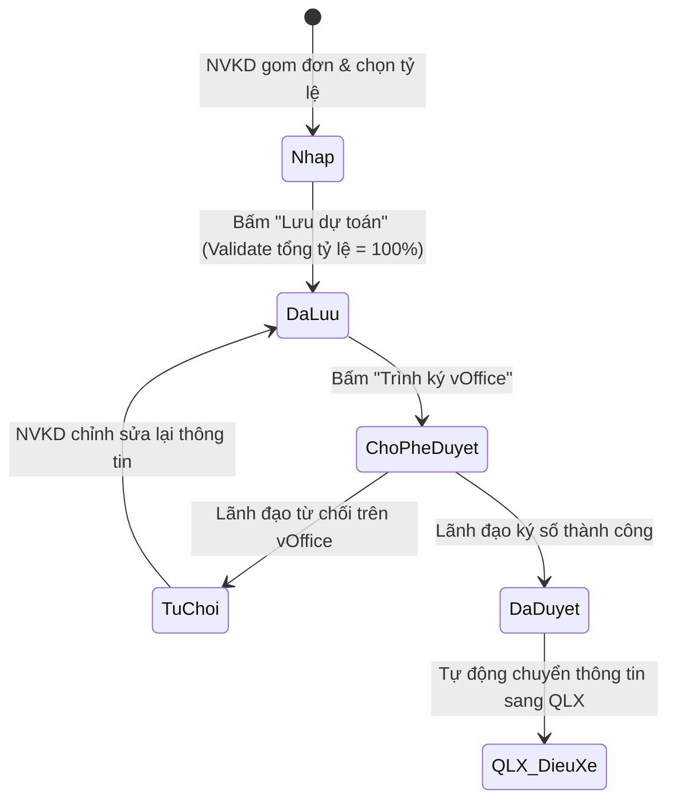

# PHÂN HỆ DỰ TOÁN VÀ TỶ LỆ CHI PHÍ / DOANH THU (BƯỚC 3 QUY TRÌNH)
## HỆ THỐNG SÀN VẬN TẢI (SMART TMS) - VIETTEL POST

---

## 1. MỤC TIÊU NGHIỆP VỤ
* Lập kế hoạch tài chính sơ bộ cho đơn hàng vận chuyển nguyên chuyến trước khi cấp lệnh điều xe.
* Tính toán các khoản mục: Doanh thu tạm tính, Chi phí thuê ngoài tạm tính, Chi phí nhiên liệu, Phí quản lý và Lợi nhuận định mức.
* Làm căn cứ để Ban Giám đốc phê duyệt tạm ứng chi phí và chuyển thông tin sang hệ thống STMS Quản Lý Xe (QLX) để gán xe.

---

## 2. MA TRẬN TRẠNG THÁI DỰ TOÁN (STATE MACHINE)

---

## 3. CÁC QUY TẮC NGHIỆP VỤ BẮT BUỘC (BUSINESS RULES)

1. **BR-DT-01 (Công thức phân bổ tỷ lệ):**  
   $$\text{Doanh thu tạm tính} = \text{Chi phí thuê ngoài} + \text{Chi phí nhiên liệu} + \text{Chi phí quản lý} + \text{Lợi nhuận định mức}$$  
   *Tổng tỷ lệ phần trăm của các khoản mục thành phần bắt buộc phải bằng đúng 100%.*
2. **BR-DT-02 (Điều kiện gom đơn):**  
   - Đơn hàng đưa vào Dự toán phải ở trạng thái **"Đã duyệt giá"** bởi CS Pricing.
   - Một đơn hàng tại một thời điểm chỉ được thuộc về duy nhất 01 Dự toán chưa hủy.
3. **BR-DT-03 (Bảo toàn số liệu khi đổi cấu hình tỷ lệ):**  
   - Bất kỳ bảng cấu hình tỷ lệ mới nào cũng chỉ áp dụng cho các Dự toán được **Tạo mới sau ngày bắt đầu hiệu lực (`Valid From`)**.
   - Các Dự toán đã ở trạng thái `Đã lưu`, `Chờ phê duyệt` hoặc `Đã duyệt` **TUYỆT ĐỐI KHÔNG ĐƯỢC PHÉP TỰ ĐỘNG TÍNH LẠI** khi người dùng mở lại màn hình xem chi tiết.
4. **BR-DT-04 (Ràng buộc trình ký vOffice):**  
   - Nút "Trình ký vOffice" chỉ sáng khi Dự toán đã được lưu thành công vào cơ sở dữ liệu.
   - Nếu quá trình gửi vOffice gặp sự cố kết nối, giữ nguyên trạng thái `Đã lưu` và hiển thị thông báo lỗi chi tiết cho người dùng.
