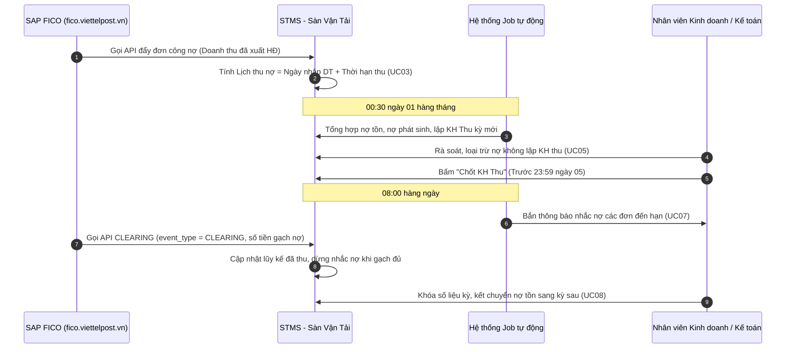

# PHÂN HỆ QUẢN LÝ CÔNG NỢ & GẠCH NỢ FICO (BƯỚC 9 QUY TRÌNH)
## HỆ THỐNG SÀN VẬN TẢI (SMART TMS) - VIETTEL POST

---

## 1. MỤC TIÊU NGHIỆP VỤ
* Quản lý công nợ khách hàng sử dụng dịch vụ Sàn Vận Tải theo kỳ (tháng).
* Tiếp nhận đơn hàng công nợ từ hệ thống SAP FICO, tự động xác định hạn thu nợ.
* Tự động lập kế hoạch thu công nợ, nhắc nợ đa kênh (SMS/Email/App) và cập nhật số tiền đã gạch nợ từ FICO.

---

## 2. LUỒNG TƯƠNG TÁC GIỮA SÀN VẬN TẢI (SVT) VÀ SAP FICO

---

## 3. CÁC QUY TẮC NGHIỆP VỤ BẮT BUỘC (BUSINESS RULES)

1. **BR-CN-01 (Công thức xác định lịch thu):**  
   $$\text{Lịch thu công nợ} = \text{Ngày nhập doanh thu} + \text{Thời hạn thu công nợ cấu hình}$$
2. **BR-CN-02 (Thời hạn chốt kế hoạch thu):**  
   - Đơn vị có trách nhiệm rà soát và bấm "Chốt kế hoạch thu" trước 23:59 ngày 05 hàng tháng.
   - Nếu đến thời điểm trên đơn vị chưa chốt, hệ thống tự động chốt số liệu tự động lúc 23:59 ngày 05.
3. **BR-CN-03 (Xử lý gạch nợ từng phần):**  
   - Khi FICO gọi API đồng bộ tiền về, hệ thống cộng dồn vào trường `Số tiền đã gạch nợ lũy kế`.
   - Chỉ khi `Số tiền đã gạch nợ` $\ge$ `Tổng tiền công nợ`, đơn mới chuyển trạng thái `Đã thu xong` và ngắt hoàn toàn tiến trình gửi tin nhắc nợ.
4. **BR-CN-04 (Khóa số liệu kỳ):**  
   - Sau khi khóa số liệu kỳ, toàn bộ chỉ số KPI và số liệu thực hiện thu bị đóng băng, công nợ chưa thu được tự động chuyển thành `Công nợ tồn` kỳ sau.
